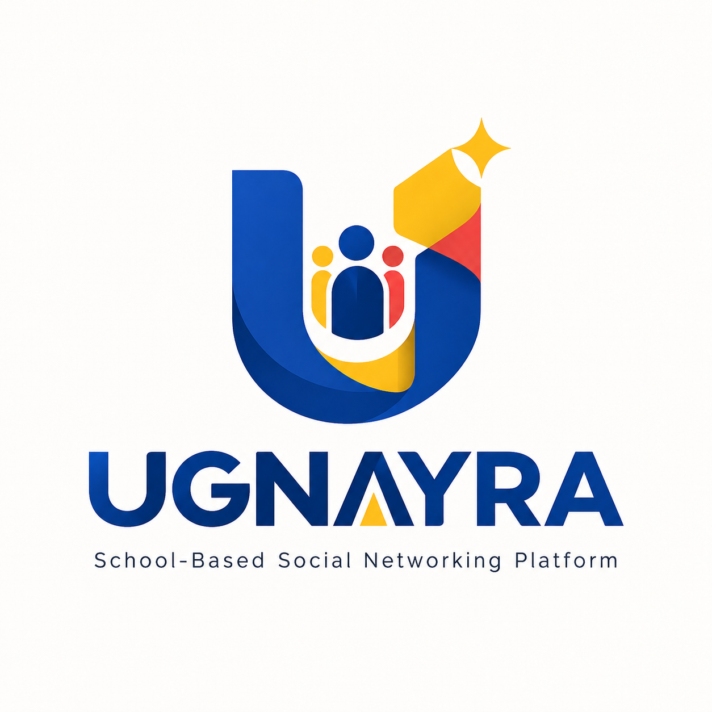

  

  <h2>School-Based Social Networking Platform</h2>

  

    A dedicated, verified campus social network engineered for students, educators, and school administrators.
  

  

    <a href="#platform-overview">Platform Overview</a> &bull;
    <a href="#core-capabilities">Core Capabilities</a> &bull;
    <a href="#campus-roles-and-permissions">Campus Roles</a> &bull;
    <a href="#design-system--user-experience">UI/UX Design</a> &bull;
    <a href="#platform-architecture">Architecture</a> &bull;
    <a href="#privacy--security-governance">Security &amp; Privacy</a> &bull;
    <a href="#academic-compliance--evaluation-rubrics">Course Compliance &amp; Rubrics</a>
  

  

    
    
    
    
    
    
    
    
    
  

---

## Platform Overview

**UGNAYRA** (derived from the Filipino word *“Ugnayan”*, signifying *connection*, *interactivity*, and *collaboration*) is an academic-first social networking platform. Modern higher education and secondary institutions frequently face severe communication fragmentation—academic discussions are scattered across commercial instant messengers, unmonitored group chats, and crowded public social media feeds.

UGNAYRA solves this challenge by delivering a **centralized, verified, and distraction-free digital campus hub**. Within UGNAYRA, every user profile is tied to a verified academic role, enabling students to collaborate on coursework, faculty members to disseminate learning materials, and campus leadership to broadcast priority advisories with immediate reach.

---

## Core Capabilities

<b>Institutional Authentication &amp; Verified Access</b>

 

- **Dual-Mode Sign-In:** Complete integration with official **Google Identity Services (OAuth 2.0)** and institutional credentials, providing passwordless single-click entry.
- **Academic Profile Onboarding:** First-time Google accounts complete an automated academic onboarding flow to declare their role, college department, student or employee ID number, year level, and section.
- **Session Hardening:** Multi-layered credential management with server-side validation and encrypted cookies.

<b>Academic Feed &amp; Scholarly Sharing</b>

 

- **Context-Aware Campus Feed:** Real-time post publication supporting multi-image carousels, academic references, and project milestone showcases.
- **Threaded Discussions:** Nested commentary and interaction trees allowing focused peer reviews, questions, and instructor feedback.
- **Audience Scope Controls:** Seamlessly toggle feed visibility between campus-wide public streams, department-exclusive broadcasts, and private community groups.

<b>Direct Peer &amp; Faculty Messaging</b>

 

- **Private Scholarly Conversations:** One-on-one communication channel between classmates, project teammates, and instructors.
- **Presence &amp; Typing Indicators:** Low-latency online indicators and live typing signals designed to facilitate rapid academic consultations.
- **Adaptive Network Engine:** Efficient delta-synchronization engine that conserves device battery and bandwidth on congested campus Wi-Fi networks.

<b>Academic Communities &amp; Subject Groups</b>

 

- **Collaborative Workspaces:** Scoped spaces for college departments, specific subject codes, student organizations, and study groups.
- **Role-Governed Membership:** Community administrators manage member rosters, oversee subject discussions, and distribute group-specific announcements.
- **Resource Depository:** Centralized timeline for study guides, lecture summaries, and collaborative project links.

<b>Verified Campus Advisories &amp; Priority Bulletins</b>

 

- **Role-Gated Publication:** Only verified faculty members and authorized campus personnel are permitted to issue institutional announcements.
- **Visual Urgency Indicators:** Visual classification across multiple priority tiers—*Urgent Advisory*, *Academic Deadline*, *Campus Event*, and *General Bulletin*.
- **Direct Activity Center:** High-visibility notification hub alerting students immediately when urgent bulletins or academic advisories are published.

---

## Campus Roles and Permissions

UGNAYRA implements a strict Role-Based Access Control (RBAC) hierarchy ensuring structured boundaries between student life and institutional administration:

| Feature &amp; Capability | Student | Faculty / Teacher | Campus Personnel |
|:---|:---:|:---:|:---:|
| **Access Campus Feed &amp; Engage in Discussions** |  |  |  |
| **Publish Academic Timeline Posts &amp; Media** |  |  |  |
| **Direct Peer &amp; Instructor Messaging** |  |  |  |
| **Join Course &amp; Club Communities** |  |  |  |
| **Create Subject or Interest Communities** |  |  |  |
| **Publish Official Campus Bulletins** |  |  |  |
| **Issue High-Priority Emergency Alerts** |  |  |  |
| **Manage Departmental Rosters** |  |  |  |

---

## Design System &amp; User Experience

The UGNAYRA interface was designed from the ground up to balance modern social media ergonomics with academic focus and accessibility:

| Design Token | Color Swatch | Hex Code | Purpose &amp; Usage |
|:---|:---:|:---:|:---|
| **Deep Navy** |  | `#173B70` | Primary brand anchor, header hierarchy, and dark mode base |
| **Royal Blue** |  | `#2864A8` | Interactive buttons, active navigation states, link highlights |
| **Warm Gold** |  | `#F5C518` | Visual accents, verification markers, and active tabs |
| **Advisory Red** |  | `#D94B45` | Priority advisories, urgent notifications, critical actions |
| **Clean Surface** |  | `#F7F8FA` | Low-strain background canvas in light mode |

### Key UX Highlights
- **Adaptive Dark / Light Themes:** Hand-calibrated contrast ratios complying with WCAG 2.1 AA standards, minimizing eye fatigue during late-night study sessions.
- **Mobile-First Responsive Shell:** Adaptive layout offering a floating bottom bar on mobile screens and an expansive productivity sidebar on desktop viewports.
- **Vector Iconography:** Powered by crisp, modern SVG icons that scale without pixelation across high-density displays.
- **Zero Content Layout Shift (CLS):** Pre-allocated image frames and skeleton loading states ensure stable rendering during asynchronous data retrieval.

---

## Platform Architecture

UGNAYRA operates on a decoupled client-server architecture designed for reliability, fast initial loads, and independent scalability:

  

<b>View Interactive Mermaid Flow Diagram</b>

 

```mermaid
flowchart LR
    classDef client fill:#0c4a6e,stroke:#38bdf8,stroke-width:2px,color:#f0f9ff
    classDef server fill:#1e3a8a,stroke:#60a5fa,stroke-width:2px,color:#eff6ff
    classDef cloud fill:#064e3b,stroke:#34d399,stroke-width:2px,color:#ecfdf5

    subgraph Client["Static Web Client (Vercel SPA)"]
        direction TB
        C1["HTML5 &amp; CSS3 Tokens"]:::client
        C2["Vanilla ES6+ Reactive Store"]:::client
        C3["jQuery 3.7 AJAX Engine"]:::client
    end

    subgraph Server["Backend REST API (Render Docker)"]
        direction TB
        S1["PHP 8.2+ PSR-4 Router"]:::server
        S2["Security Pipeline (CSRF / RBAC)"]:::server
        S3["Domain Services (Auth, Feed, Chat)"]:::server
        S4["PDO Parameterized Queries"]:::server
    end

    subgraph Cloud["Cloud Infrastructure (Supabase &amp; Google)"]
        direction TB
        D1[("Supabase PostgreSQL 15")]:::cloud
        D2["Google Identity Services (OAuth 2.0)"]:::cloud
        D3[("Media Storage (ugnayra-media)")]:::cloud
    end

    Client <== "HTTPS JSON (/api/v1/*)" ==> Server
    Server <== "TLS / SQL (Pooler :5432)" ==> Cloud
```

- **Frontend Application:** Zero server-side rendering overhead. Assets are pre-minified and distributed globally via Content Delivery Networks for instantaneous edge delivery.
- **Backend Application Programming Interface:** Modular PHP 8.2 service architecture handling request authentication, CSRF validation, rate limiting, and business logic execution.
- **Database &amp; Object Storage:** PostgreSQL relational database with foreign-key referential integrity, indexed query paths, and dedicated object storage for verified media files.

---

## Privacy &amp; Security Governance

UGNAYRA is engineered with security and privacy by design:

- **Strict Identity Verification:** Academic accounts are protected by multi-tier authentication, preventing impersonation and unverified access.
- **Encrypted Communication:** All data in transit is enforced via TLS/HTTPS, and all database operations utilize parameterized queries to eliminate SQL injection vectors.
- **Cross-Site Request Forgery (CSRF) Prevention:** Mutating state operations require validated CSRF tokens alongside SameSite cookie protections.
- **Input Sanitization &amp; Output Encoding:** Multi-layer sanitization pipelines guard against Cross-Site Scripting (XSS) across all rich-text and comment inputs.
- **Rate-Limiting Protection:** Token-bucket rate limiting safeguards login endpoints and API resources against abusive brute-force attempts.

---

## Academic Compliance &amp; Evaluation Rubrics

This project is submitted as the **Final Course Project &amp; Term Compilation** for the academic course:

| Academic Parameter | Specification Details |
|:---|:---|
| **Course Code &amp; Title** | **IT 305W &mdash; Advanced Web Application** |
| **Curricular Level** | 3rd Year &mdash; 1st Semester |
| **Project Category** | Final Course Project Compilation (Major Subject Requirement) |
| **Project Nomenclature** | UGNAYRA: School-Based Social Networking Platform |
| **Student Proponent** | **Raymart Quirante** |
| **Architecture Specification** | Decoupled Client-Server Monorepo (Static SPA + PHP 8.2+ REST API + Supabase PostgreSQL) |
| **Compliance Status** | 100% Fully Compliant across all course project rubrics |

### Rubrics Alignment &amp; Implementation Matrix

The platform is engineered to fulfill and exceed the rigorous assessment standards of **IT 305W (Advanced Web Application)**:

| Grading Rubric Criteria | Curricular Requirement &amp; Assessment Focus | UGNAYRA Technical Implementation &amp; Evidence | Status |
|:---|:---|:---|:---:|
| **1. Advanced Client-Side Architecture (SPA)** | Elimination of full-page reloads, state management, asynchronous data orchestration, dynamic view rendering, and client-side routing. | Built with Vanilla ES6+ modules and jQuery 3.7 AJAX. Features a centralized reactive State Store (`store.js`), dynamic template caching (`templateLoader.js`), and clean URL routing with zero hash `#` artifacts. |  |
| **2. Robust Server-Side REST API Engineering** | Clear separation of concerns, PSR-compliant architecture, decoupled controllers, modular services, request validation, and uniform response envelopes. | Engineered with PHP 8.2+ using custom PSR-4 routing, pipeline middleware, domain services (`AuthService`, `PostService`, `ChatService`), and standardized JSON envelopes (`success`, `data`, `message`, `errors`). |  |
| **3. Database Normalization &amp; Relational Integrity** | Normalized relational schema (3NF), foreign-key constraints, UUID primary keys, composite indexing, and transactional data integrity. | Powered by Supabase PostgreSQL 15+. Implements RFC 4122 v4 UUIDs, strict cascade/restrict foreign keys, cursor pagination composite indexes, and parameterized queries via PDO (`pdo_pgsql`). |  |
| **4. Enterprise Security, Auth &amp; Governance** | Multi-tier authentication, secure session handling, CSRF defense, role-based access control (RBAC), and sanitization pipelines. | Incorporates native bcrypt password hashing alongside official **Google Identity Services (OAuth 2.0)** with campus onboarding. Enforces SameSite/HttpOnly cookies, CSRF tokens, and 3-tier RBAC (`Student`, `Teacher`, `Personnel`). |  |
| **5. Responsive Design System &amp; Ergonomics** | Mobile-first responsiveness, visual hierarchy, dark/light theme adaptability, accessibility (WCAG AA), and high-fidelity typography. | Crafted using pure CSS3 design tokens (`--color-navy`, `--color-royal`, etc.) with zero UI framework bloat. Features high-contrast dark/light theme switching, responsive bottom bar/sidebar shells, and scalable vector SVG icons. |  |
| **6. Real-Time &amp; Asynchronous Capabilities** | Asynchronous interactivity, direct communication channels, presence signaling, and event-driven data flow. | Implements a battery-friendly delta-polling messaging engine with `document.visibilityState` throttling, real-time typing indicators, unread notification badges, and thread discussions. |  |
| **7. Software Engineering &amp; Verification** | Clean code organization, separation of frontend/backend concerns, automated unit testing, and version control discipline. | Follows decoupled monorepo best practices. Validated by an automated 12-suite backend test runner (`php backend/tests/run.php` &mdash; 100% passing) with automated production bundling and minification. |  |

---

  

    <strong>UGNAYRA</strong> &bull; School-Based Social Networking Platform
  

  

    Final Course Project submitted in partial fulfillment of the course requirements for 
    <strong>IT 305W &mdash; Advanced Web Application</strong> (3rd Year, 1st Semester)
  

  

    Developed by <strong>Raymart Quirante</strong>
  

