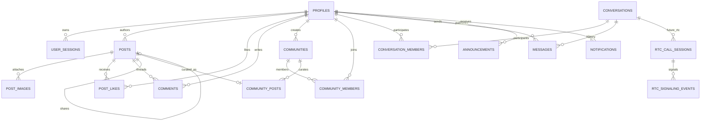

# UGNAYRA — Database Design & Security Specification

**Database Engine:** Supabase PostgreSQL 15+  
**Access Layer:** PHP 8.2+ `PDO` (`pdo_pgsql`) with 100% Parameterized Prepared Statements  
**Schema Files:**
- Canonical single-run schema: `database/schema.sql`
- Modular migrations: `database/migrations/001` through `004`
- Row Level Security policies: `database/policies/001_supabase_rls_policies.sql`
- Demo academic dataset: `database/seeders/001_academic_demo_seed.sql`

---

## 1. Normalization & Design Decisions

1. **UUIDv4 Primary Keys (`gen_random_uuid()`):** Prevents sequential ID enumeration attacks across profiles, private conversations, messages, and posts.
2. **Case-Insensitive Academic Identifiers (`CITEXT`):** `profiles.email`, `profiles.username`, and `communities.slug` use PostgreSQL `CITEXT` so `Alyssa.Reyes@ugnayra.edu.ph` and `alyssa.reyes@ugnayra.edu.ph` never create duplicate accounts.
3. **Zero Post Table Duplication:** Instead of maintaining disconnected campus and community post tables with duplicate like/comment logic, `posts` stores all posts once, referencing optional `community_id` and optional `shared_post_id`, while `community_posts` stores strictly community-specific curation metadata (`is_announcement`, `is_pinned`, `pinned_by`).
4. **Deterministic 1-to-1 Conversation Uniqueness:** `conversations.direct_key` stores the sorted pair `"<smaller_uuid>:<larger_uuid>"` with a `UNIQUE` constraint so concurrent AJAX clicks on "Message Classmate" can never spawn duplicate 1-to-1 threads.
5. **Trigger-Maintained Read Counters:** `likes_count`, `comments_count`, `shares_count`, `members_count`, and `posts_count` are maintained atomically via PL/pgSQL `AFTER INSERT OR DELETE` triggers (`GREATEST(0, count - 1)`), giving fast `O(1)` feed reads without expensive `COUNT(*)` subqueries on every scroll.
6. **Structured JSONB Columns (IT305W JSON Rubric Alignment):** `profiles.preferences` and `notifications.metadata` use PostgreSQL `JSONB` for extensible structured client/server JSON manipulation alongside relational integrity.

---

## 2. Entity-Relationship Diagram

---

## 3. Foreign Key & Deletion Cascade Matrix

| Child Table | Foreign Key | Referenced Table | `ON DELETE` Behavior | Rationale |
|---|---|---|---|---|
| `user_sessions` | `user_id` | `profiles(id)` | `CASCADE` | Removing an account revokes all sessions immediately |
| `posts` | `author_id` | `profiles(id)` | `CASCADE` | Author removal cleans owned posts |
| `posts` | `community_id` | `communities(id)` | `CASCADE` | Deleting a community cleans scoped posts |
| `posts` | `shared_post_id` | `posts(id)` | `SET NULL` | If original post is deleted, shared wrapper gracefully shows unavailable notice |
| `post_images` | `post_id` | `posts(id)` | `CASCADE` | Deleting a post removes image attachment rows |
| `post_likes` | `post_id`, `user_id` | `posts`, `profiles` | `CASCADE` | Likes clean up automatically & trigger decrements counter |
| `comments` | `post_id`, `author_id` | `posts`, `profiles` | `CASCADE` | Deleting a post removes its comment tree |
| `comments` | `parent_comment_id` | `comments(id)` | `CASCADE` | Deleting a parent comment removes nested replies |
| `communities` | `created_by` | `profiles(id)` | `RESTRICT` | Prevents accidental deletion of institutional community creator without reassignment |
| `announcements` | `author_id` | `profiles(id)` | `RESTRICT` | Preserves audit accountability on official school announcements |
| `messages` | `conversation_id` | `conversations(id)` | `CASCADE` | Deleting thread removes message history |
| `notifications` | `recipient_id` | `profiles(id)` | `CASCADE` | Recipient cleanup removes inbox alerts |
| `notifications` | `actor_id` | `profiles(id)` | `SET NULL` | Preserves notification history if actor account is removed |

---

## 4. Indexing Strategy for Low-Latency AJAX

- **Campus Feed Cursor Pagination:** `idx_posts_campus_feed` on `posts (created_at DESC, id DESC) WHERE visibility = 'campus'`
- **Community Feed Pagination:** `idx_posts_community_feed` on `posts (community_id, created_at DESC, id DESC)`
- **Private Chat Delta Polling:** `idx_messages_conv_created` on `messages (conversation_id, created_at ASC, id ASC)`
- **Unread Notifications Badge:** `idx_notifications_recipient_unread` on `notifications (recipient_id, is_read, created_at DESC)`
- **Online Classmates Sidebar:** `idx_profiles_last_seen` on `profiles (last_seen_at DESC NULLS LAST) WHERE is_active = TRUE`
- **Unified Campus Search:** GIN trigram (`pg_trgm`) indexes on `profiles` & `communities` + GIN full-text (`to_tsvector`) indexes on `posts` & `announcements`.

---

## 5. Supabase RLS & PHP Access Model

Supabase projects expose tables in the `public` schema via PostgREST by default unless Row Level Security (RLS) is enabled. To prevent unauthorized external API reads of `profiles.password_hash`, `user_sessions`, or private `messages`:
1. **RLS is enabled on all 16 tables** in `database/policies/001_supabase_rls_policies.sql`.
2. Direct `anon` table privileges on credential, messaging, and notification tables are explicitly revoked.
3. The PHP 8.2+ backend enforces authentication, CSRF validation, and RBAC (`student`, `teacher`, `personnel`) in PHP Middleware and Services before executing parameterized PDO queries, and can additionally bind `SET LOCAL app.current_user_id` inside transactions for defense-in-depth parity with PostgreSQL RLS policies.
