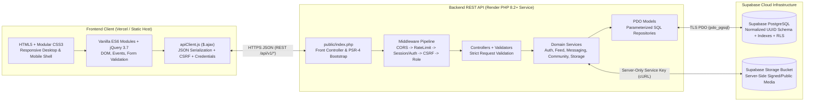
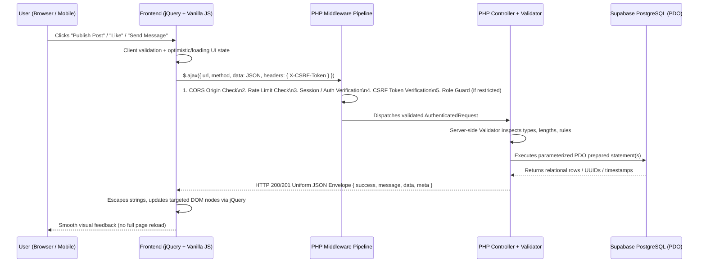

# UGNAYRA — System Architecture Specification

**Project:** UGNAYRA — School-Based Social Networking Platform  
**Architecture Pattern:** Decoupled Client–Server Monorepo (Static Frontend + PHP 8.2+ REST API + Supabase PostgreSQL)

---

## 1. Architectural Principles

1. **Strict Frontend / Backend Separation:** `frontend/` contains zero PHP code or credentials and deploys independently as a static web application on **Vercel**. `backend/` contains zero HTML presentation views and deploys independently as a **PHP 8.2+ Web Service on Render**.
2. **Asynchronous JSON-First Communication:** Every post creation, reaction, comment, private message, community interaction, search query, and notification read occurs asynchronously through jQuery `$.ajax` calls exchanging structured JSON payloads — eliminating disruptive full-page reloads.
3. **Defense-in-Depth Security:** Authentication, role-based authorization (`student`, `teacher`, `personnel`), CSRF validation, input sanitization, prepared SQL queries, rate limiting, and file MIME verification are enforced inside trusted PHP middleware and services — never delegated to client UI visibility.
4. **Honest Real-Time Semantics:** Messaging, typing status, online presence, and notification badges use an optimized, visibility-aware AJAX delta-polling engine (`since` cursors + `document.visibilityState` throttling) so low-end devices and campus networks stay fast and battery-efficient without fabricating WebSocket claims.
5. **Intentional Academic Product Identity:** The visual system is anchored in UGNAYRA's Deep Navy (`#173B70`), Royal Blue (`#2864A8`), Warm Yellow (`#F5C518`), and controlled Muted Red (`#D94B45`) accents on clean Off-White (`#F7F8FA`) and White (`#FFFFFF`) surfaces.

---

## 2. High-Level System Topology

---

## 3. Repository & Module Boundaries

| Top-Level Directory | Responsibility | Deployment Target | Allowed Technologies |
|---|---|---|---|
| `frontend/` | User interface, client routing/view switching, jQuery AJAX orchestration, responsive layouts, accessibility, client-side validation & XSS output escaping | **Vercel** | HTML5, CSS3, Vanilla JS, jQuery 3.7, Lucide Icons |
| `backend/` | REST API routing, session/token auth, RBAC, CSRF enforcement, server-side validation, business services, PDO database queries, media upload inspection | **Render** (Docker PHP 8.2+) | PHP 8.2+, PDO (`pdo_pgsql`), cURL, Composer / PSR-4 |
| `database/` | Canonical `schema.sql`, sequential SQL migrations, academic demo seeders, and Supabase RLS policy scripts | **Supabase PostgreSQL** | PostgreSQL 15+ SQL / PL/pgSQL |
| `docs/` | Architecture specification, database ER documentation, API contract, and deployment guides | Repository Documentation | Markdown + Mermaid |

---

## 4. End-to-End Request Lifecycle

---

## 5. Authentication, Session, CSRF & Cross-Origin Strategy

Deploying the frontend on **Vercel** and the backend on **Render** introduces cross-origin browser privacy constraints (Safari ITP and Chromium third-party cookie partitioning). UGNAYRA solves this cleanly while honoring PHP native session management and CSRF protection:

1. **Primary Deployment Mode (Vercel API Proxy Rewrite + Native PHP Sessions):**
   - On Vercel, `frontend/vercel.json` proxies `/api/v1/:path*` to `${RENDER_BACKEND_URL}/api/v1/:path*`.
   - From the browser's perspective, requests originate from the **same site**, allowing hardened first-party cookies (`HttpOnly; Secure; SameSite=Lax`) to work across all desktop and mobile browsers without third-party cookie rejection.
2. **Direct Cross-Origin Mode (Local Dev `localhost:3000` ↔ `localhost:8080` or Separate Origins):**
   - `CorsMiddleware` validates `Origin` against the `FRONTEND_ORIGIN` allowlist and emits `Access-Control-Allow-Credentials: true`.
   - PHP sets `session_regenerate_id(true)` upon login and persists active sessions in PostgreSQL (`user_sessions` table) alongside PHP's session state, issuing both a hardened session cookie and a rotating CSRF token (`X-CSRF-Token`), plus an optional bearer session fallback if third-party cookies are blocked in strict cross-domain testing.
3. **Role-Based Access Control (RBAC):**
   - `student`: Standard campus posting, commenting, liking, sharing, private messaging, joining/participating in communities, viewing announcements.
   - `teacher`: Verified Faculty badge, publishing academic/class announcements, creating/moderating academic communities, full social & messaging features.
   - `personnel`: Authorized School Personnel badge, publishing campus-wide & urgent priority announcements, pinning bulletins, platform/community moderation.

---

## 6. Supabase PostgreSQL Integration Architecture

- **Driver:** PHP `PDO` with `pdo_pgsql` over TLS (`sslmode=require`).
- **Connection Pool Compatibility:** Supabase provides two connection endpoints:
  - **Session Pooler (Port `5432`):** Full PostgreSQL prepared-statement lifecycle (`PDO::ATTR_EMULATE_PREPARES => false`). Recommended default for Render IPv4 containers and local development.
  - **Transaction Pooler (Port `6543`):** High-concurrency Supavisor transaction pooling; `Database.php` automatically switches `PDO::ATTR_EMULATE_PREPARES => true` when `DB_POOL_MODE=transaction` so unnamed prepared statements never collide across pooled transactions.
- **Row Level Security (RLS) Alignment:** Direct PostgreSQL connections using the database owner role bypass PostgREST RLS by default. Therefore:
  1. Every authorization rule is strictly enforced in PHP Services/Middleware before query execution.
  2. Matching PostgreSQL RLS policies are authored in `database/policies/` and enabled on all public tables so the Supabase Data API / PostgREST surface is locked down if enabled on the Supabase project.

---

## 7. Visibility-Aware AJAX Delta Polling

To power **Private Messaging**, **Online Classmates Presence**, **Typing Indicators**, and **Unread Notification Counts** honestly without WebSockets:

- **Active Conversation View:** Polls `GET /api/v1/conversations/{id}/messages?after={last_message_created_at}` every **3.5 seconds** while the conversation pane is focused and `document.visibilityState === 'visible'`. Piggybacks typing state (`is_typing` TTL = 6 seconds) in lightweight JSON metadata.
- **Global Heartbeat & Badge Sync:** Polls `POST /api/v1/presence/heartbeat` every **25 seconds** when the tab is visible (paused or backed off to 90s when hidden), updating `profiles.last_seen_at` and returning `{ unread_messages_count, unread_notifications_count, online_contacts }` in a single compact round-trip instead of multiple redundant requests.

---

## 8. Media Upload & Storage Architecture

- **Validation Gate (`UploadValidator`):**
  1. Rejects files exceeding `UPLOAD_MAX_BYTES` (default 5 MB).
  2. Inspects magic bytes via PHP `finfo_file(FILEINFO_MIME_TYPE)` — permits only `image/jpeg`, `image/png`, `image/webp`, and `image/gif`.
  3. Verifies image dimensions with `getimagesize()` to block polyglot payloads.
  4. Generates a non-guessable UUIDv4 filename (`{uuid}.{ext}`) — never trusts `$_FILES['name']`.
- **Storage Drivers (`StorageService`):**
  - `local`: Writes to `backend/public/uploads/{category}/` for zero-config local development.
  - `supabase`: Streams validated binary server-to-server via PHP cURL to Supabase Storage (`${SUPABASE_URL}/storage/v1/object/${BUCKET}/...`) using `SUPABASE_SERVICE_ROLE_KEY` stored solely in `backend/.env` (vital because Render container filesystems are ephemeral across redeploys).

---

## 9. Future-Ready WebRTC Video Conferencing Boundary

Per Section 6.I, UGNAYRA prepares a clean, isolated architectural seam for peer-to-peer WebRTC consultations without placing non-functional placeholder call buttons in the core UI:
- **Database Seam:** Optional signaling schema (`rtc_call_sessions` and `rtc_signaling_events`) documented and isolated in `database/migrations/` for SDP Offer/Answer and ICE candidate relay.
- **Backend Seam:** Reserved route namespace `/api/v1/rtc/*` (`SignalingController`) decoupled from core messaging controllers.
- **Frontend Seam:** Isolated module path `frontend/src/js/modules/rtc/` with feature flag `FEATURES.WEBRTC_CALLING = false` by default until STUN/TURN infrastructure is provisioned.

---

## 10. IT305W Rubric Traceability Matrix

| Rubric Criterion | Weight | Architectural Fulfillment in UGNAYRA |
|---|---|---|
| **JSON Implementation** | 20 pts | Uniform JSON response/error envelopes from PHP (`JsonResponse`), JSON request body parsing, client-side JSON state transformation, cursor metadata, and structured validation error maps. |
| **AJAX Implementation** | 20 pts | Centralized `$.ajax` client powering zero-reload post CRUD, likes, comments, shares, debounced live search, community membership, notifications, and delta-polled messaging. |
| **PHP Server-Side Processing** | 20 pts | Layered PHP 8.2+ architecture (`Controllers`, `Services`, `Models`, `Validators`, `Middleware`, `Helpers`), native + DB-backed session lifecycle, RBAC, and multipart file processing. |
| **HTML and CSS** | 10 pts | Semantic HTML5 landmarks (`header`, `nav`, `main`, `aside`, `article`, `dialog`), custom CSS3 design-token system, responsive 3-column desktop to native-feel bottom-nav mobile layout. |
| **jQuery Bonus Integration** | +5 pts | Meaningful jQuery 3.7 usage across `$.ajax` transport, delegated event handling, dynamic feed/chat DOM injection, form state/validation feedback, and accessible modal/toast transitions. |
| **Database / Data Management** | 10 pts | Normalized 3NF Supabase PostgreSQL schema with UUID primary keys, cascading foreign keys, unique constraints, composite indexes, and 100% parameterized PDO queries. |
| **System Functionality & Integration** | 10 pts | End-to-end integration across Auth, Profiles, News Feed, Messaging, Communities, Announcements, Notifications, and Search. |
| **Creativity, UX & Interface Design** | 5 pts | Purpose-built academic social identity using UGNAYRA's Navy/Royal Blue, Warm Yellow, and controlled Red accent palette with WCAG AA contrast and complete empty/loading/error states. |
| **Security, Validation & Error Handling** | 5 pts | `password_hash`/`password_verify`, PDO prepared statements, XSS output escaping, CSRF tokens, CORS allowlist, rate limiting, safe uploads, `.env` secrets, sanitized JSON errors. |

---

## 11. Local Workspace Environment Notes

During Phase 1 inspection of the local development machine:
- **Brand Asset Found:** `ugnayra_logo.png` (`1254x1254`) was inspected and cleanly extracted into transparent, web-optimized brand assets in `frontend/public/assets/logos/` (`ugnayra-mark.png`, `ugnayra-wordmark.png`, `ugnayra-logo-full.png`) and multi-resolution `frontend/public/favicon.ico`.
- **Runtime Inspection:**
  - `git` `2.55.0`, `node` `v24.22.1`, and `python` `3.14.7` are installed on `PATH`.
  - Local XAMPP PHP was detected at `C:\xampp\php\php.exe` (version `8.0.30`) with `php_pdo_pgsql.dll` and `php_pgsql.dll` available in `C:\xampp\php\ext\`.
  - **Target Runtime:** Production (`backend/composer.json` and Render `Dockerfile`) targets **PHP 8.2+**. For local testing, upgrading local PHP to **PHP 8.2/8.3** (e.g., `winget install PHP.PHP.8.3`) is recommended, and the backend bootstrap also includes a zero-dependency PSR-4 autoloader so Composer does not block local startup.
